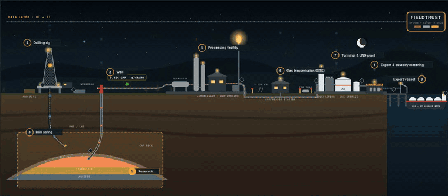
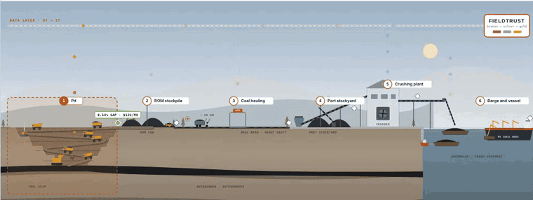
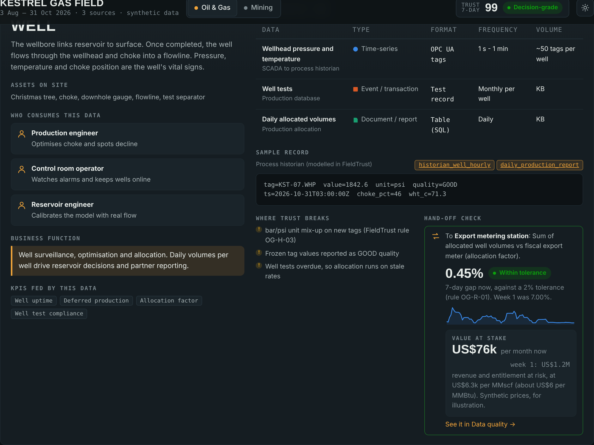
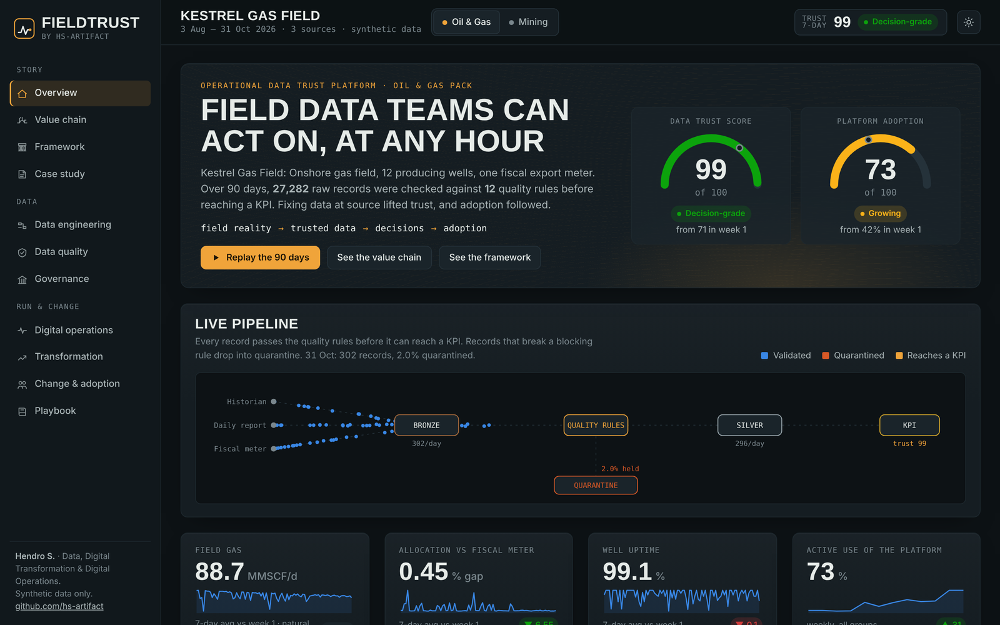
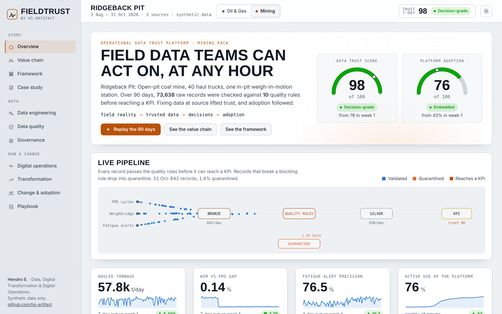
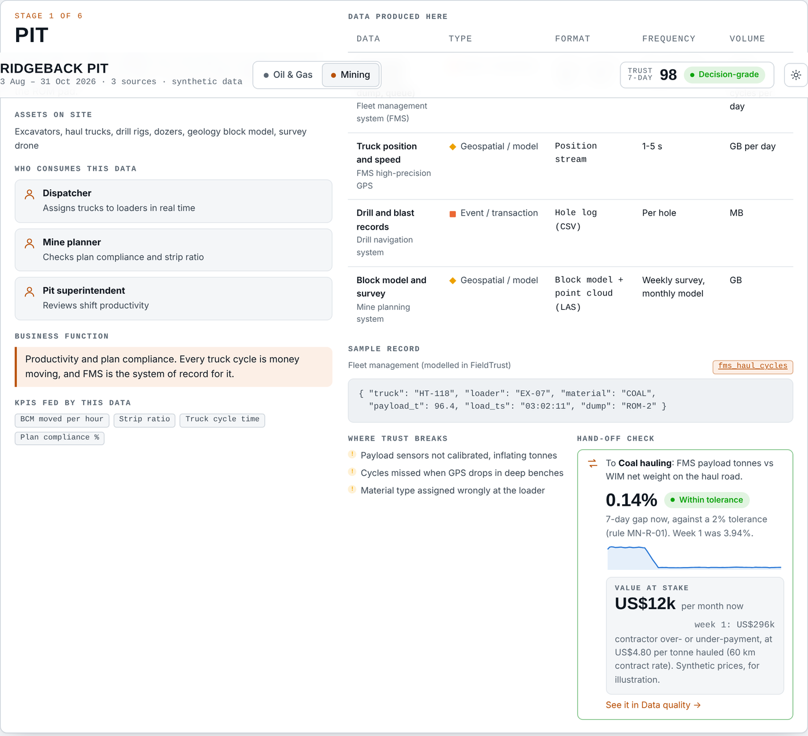
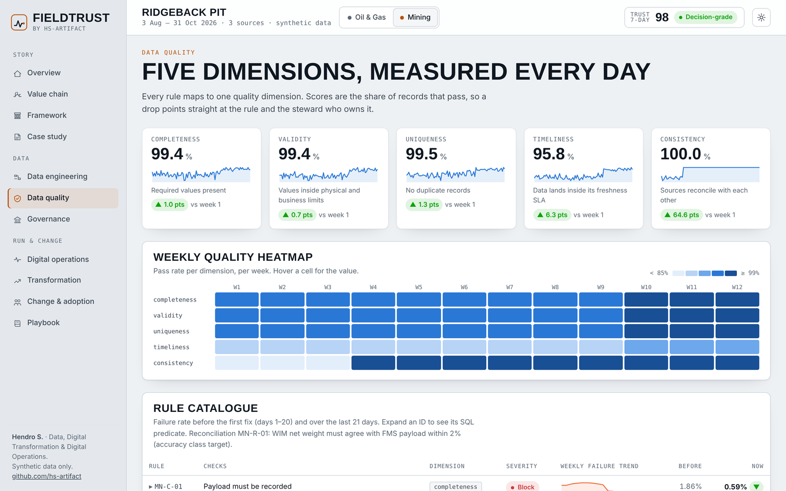

# FieldTrust

**An operational data trust platform for oil & gas and mining.**
Field reality → trusted data → decisions → adoption.

[](https://hs-artifact.github.io/fieldtrust/)
[](https://github.com/hs-artifact/fieldtrust/actions/workflows/ci.yml)
[](https://github.com/hs-artifact/fieldtrust/actions/workflows/pages.yml)


> "If it doesn't work at 3 AM on night shift, it doesn't work."

**[Open the live demo →](https://hs-artifact.github.io/fieldtrust/#value-chain)**

### For hiring managers: where to look

| If you are hiring for | Start here | What it shows |
|---|---|---|
| **Senior Data Engineer, oil & gas** | [`pipeline/medallion.py`](pipeline/medallion.py), [`governance/contracts/`](governance/contracts), [`tests/`](tests) | Contract-driven bronze → silver → gold pipeline, rules as SQL predicates, quarantine, tests gating every deploy |
| **Petroleum / Hydrocarbon Data Analyst** | [Value chain → Well](https://hs-artifact.github.io/fieldtrust/#value-chain) and [`governance/valuechain.yml`](governance/valuechain.yml) | Well test → allocation → fiscal meter hand-off, reconciliation tolerance, money at stake per month, PPDM/PRODML vocabulary |
| **Digitalization / Digital Transformation Manager** | [Framework](https://hs-artifact.github.io/fieldtrust/#framework), [Stage gates](https://hs-artifact.github.io/fieldtrust/#transformation), [Adoption](https://hs-artifact.github.io/fieldtrust/#adoption) | People, process and technology designed from the same goals; requirement → acceptance → evidence; adoption tracked against data trust |

**Hendro S.** · Balikpapan, Indonesia · open to roles in Indonesia, Malaysia and the Middle East · [hendro.sutrisno@outlook.com](mailto:hendro.sutrisno@outlook.com) · [LinkedIn](https://www.linkedin.com/in/hendro-sutrisno-8b4897220)



<table>
  <tr>
    <td width="50%"></td>
    <td width="50%"></td>
  </tr>
  <tr>
    <td></td>
    <td></td>
  </tr>
  <tr>
    <td></td>
    <td></td>
  </tr>
</table>

Dark theme plays the night shift with site lights on; light theme plays the day shift. Both run on the same data.

Most digital programmes in heavy industry rarely fail on technology. They fail on untrusted data, unclear ownership, and systems that never get accepted on site. FieldTrust is a working model of how to close that gap. It brings five disciplines together in one product:

| Discipline | What you can see in FieldTrust |
|---|---|
| **Data engineering** | Contract-driven medallion pipeline (bronze → silver → gold), quarantine, reproducible daily runs |
| **Data governance** | Owners and stewards per dataset, KPI glossary, RACI, lineage from source to KPI |
| **Data quality** | Five dimensions scored daily, a rule catalogue with SQL predicates, before/after evidence |
| **Digital operations** | 24×7 source monitoring, SLA against target, incidents raised by the rule engine, MTTR, runbook |
| **Transformation & change** | Requirement → acceptance → evidence stage gates, ADKAR by user group, stakeholder map, adoption tied to trust |

It is organised around one operating model, the **Field-to-Decision Transformation Framework**: strategy and goals set the direction; people, process and technology are designed together from the same goals and pain points; governance binds them; data underpins every decision, both *data for decisions* (baselines, pain points, adoption) and *data from technology* (on purpose, on time, relevant, trusted); and value is tracked back to the strategic result.

What you can explore:

- **Value chain:** an animated cross-section of each business, from reservoir to export vessel and from pit to shipment. Every stage shows the data it produces (type, format, frequency, volume), a sample record, who consumes it, the business function it serves, and the hand-off check where trust usually breaks. Where FieldTrust models the hand-off, the marker shows the live gap and the money at stake each month (synthetic prices). Dark theme plays the night shift, light theme the day shift
- **Framework:** an interactive map of the model, a goal tree, a stakeholder-layer table from frontline crews to leadership, governance maturity, and a *what-if* simulator that switches people, process or technology off to show what happens to trust and adoption
- **Playbook:** normal and edge cases (good data nobody uses, everyone using wrong data, shadow spreadsheets, night-shift connectivity loss, safety-critical alarm tuning and more), each with symptom, data signal, root cause and resolution
- **Replay:** watch the 90 days unfold, with the live pipeline animation, trust and adoption moving day by day

Two domain packs run on the same core:

- **Kestrel Gas Field (oil & gas):** 12 wells, process historian, daily production report, fiscal export meter
- **Ridgeback Pit (mining):** 40 haul trucks, fleet management cycles, weigh-in-motion, fatigue alerts

All sites, people and figures are fictional. All data is synthetic.

---

## The story in the data

Each domain starts with the kinds of defects real field data carries. Programme interventions fix them at source:

1. **Technology:** fix the instrument or interface (unit mapping on historian tags, WIM loadcell calibration)
2. **Process:** change how data is captured (a validated digital daily report, fatigue threshold tuning)
3. **People:** assign ownership and coach supervisors (RACI sign-off, ADKAR reinforcement)

The data trust score rises after each fix. Adoption follows about two weeks later. FieldTrust measures that link as a correlation between weekly trust and adoption.

## Quick start

```bash
pip install -r requirements.txt
python pipeline/run.py            # generate → validate → score → publish JSON
python -m http.server -d app 8000 # open http://localhost:8000
```

Run the tests (data contracts, rule engine, trust score, value-chain map):

```bash
pip install -r requirements-dev.txt
python -m pytest -q
```

The same tests run in GitHub Actions on every push, and the site only deploys when they pass.

`pipeline/run.py` takes a few seconds. It rebuilds `app/data/fieldtrust.json` and writes SQLite databases to `data/` so you can query each layer:

```bash
sqlite3 data/mining.db "SELECT failed_rules, COUNT(*) FROM quarantine_fms_haul_cycles GROUP BY 1 ORDER BY 2 DESC;"
```

## How it works

```
governance/framework.yml     ← the transformation framework and playbook
governance/valuechain.yml    ← physical value chain mapped to data, consumers and functions
governance/contracts/*.yml   ← owners, freshness SLAs, quality rules (SQL predicates)
governance/programme/*.yml   ← goal tree, stakeholder layers, RACI, stage gates, ADKAR, maturity
          │
pipeline/generate.py         → bronze: raw synthetic source systems with realistic defects
pipeline/medallion.py        → staging SQL, rule engine, silver + quarantine, gold SQL
pipeline/run.py              → trust score, ops & incidents, adoption, JSON bundle
          │
app/                         ← static web app (vanilla JS + hand-built SVG), no build step
```

A quality rule is plain data:

```yaml
- id: OG-H-03
  dimension: validity
  severity: block
  description: Wellhead pressure within physical envelope (300-3000 psi); catches bar/psi unit mix-ups
  valid_when: whp_psi BETWEEN 300 AND 3000
```

The engine turns every rule into a SQL column (`CASE WHEN COALESCE((predicate), 0) THEN 0 ELSE 1 END`). Rows that fail a `block` rule go to quarantine with the IDs they broke. Rows that fail only `warn` rules are promoted with a flag. Gold KPIs read silver only.

**Data trust score** = 0.7 × rule pass rate + 0.3 × reconciliation score. Reconciliation compares independent sources: allocated well volumes against the fiscal meter, or WIM net weight against on-board payload.

See [docs/architecture.md](docs/architecture.md) for details and [docs/roadmap.md](docs/roadmap.md) for what comes next.

## Deploy

The `app/` folder is a static site. The included GitHub Actions workflow (`.github/workflows/pages.yml`) runs the pipeline and publishes `app/` to GitHub Pages on every push to `main`. In the repository go to **Settings → Pages → Source: GitHub Actions**.

## About

Built by **Hendro S.** ([hs-artifact](https://github.com/hs-artifact)): 15+ years across an international oil major, national upstream operators and large-scale open-pit coal mining, working at the point where operations, data, governance and people meet.

The domain model, quality rules, reconciliation tolerances, acceptance criteria and adoption logic come from that field experience. The code was written with AI-assisted development; every rule, test and number in it is one I can explain and defend.

Background: Information Systems graduate who started as a Java developer, then application support and system engineering at an international oil major (SME for 187 applications through an operator transition), senior system and data engineer at national upstream operators (Oracle, SQL Server, PostgreSQL, Talend, PI Asset Framework), and head of digital operations at a large open-pit coal mine. PSPO I.

**Contact:** [hendro.sutrisno@outlook.com](mailto:hendro.sutrisno@outlook.com) · [LinkedIn](https://www.linkedin.com/in/hendro-sutrisno-8b4897220) · Balikpapan, Indonesia (UTC+8)

## License

MIT
